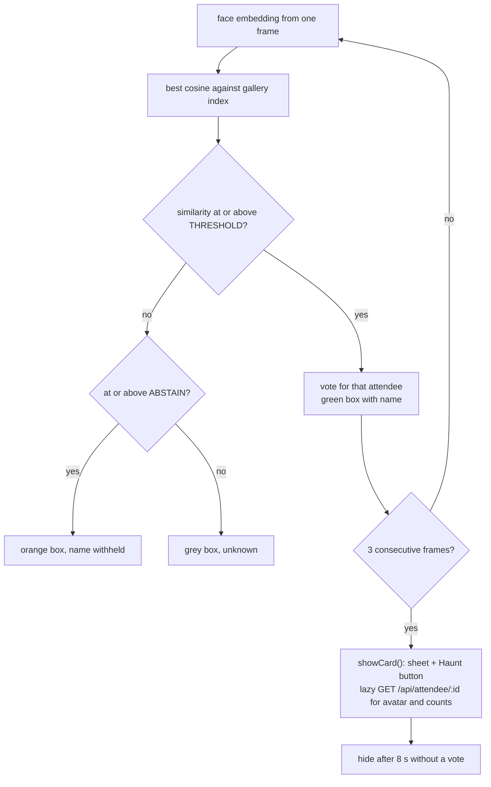
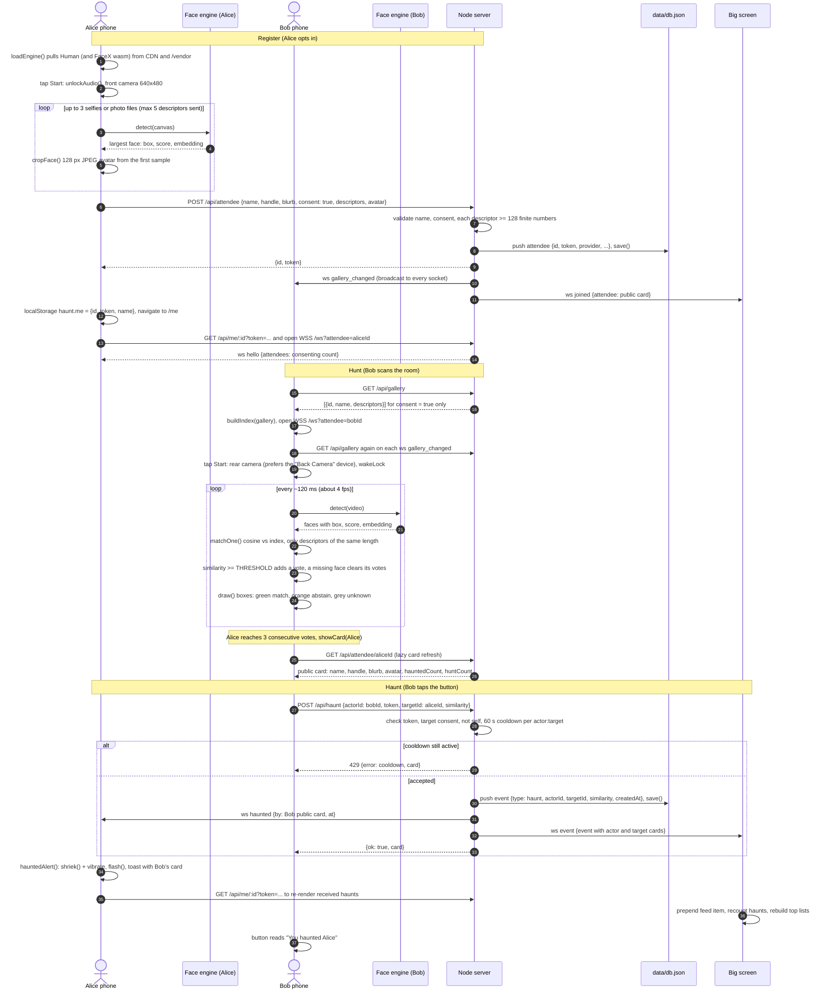
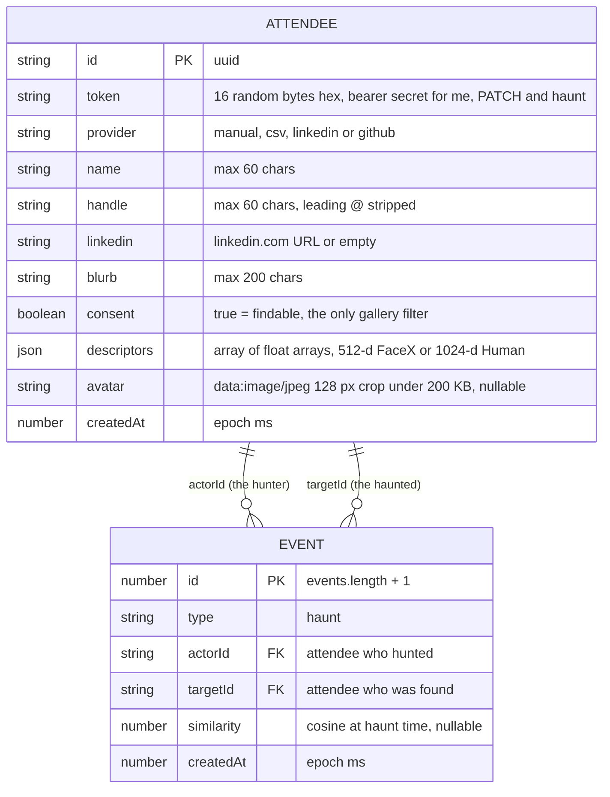

# HAUNT architecture diagrams

HAUNT is one Node process serving a handful of static pages to phones in a room. Every face-related
computation (detect, align, embed, match) runs inside the phone's browser via `web/face.js`, which
loads either the FaceX EdgeFace-XS embedder or Human's FaceRes embedder on a TensorFlow.js wasm
backend. The server (`server/index.js`, Express + `ws`) only ever receives float descriptors,
profile text and a small avatar crop, stores them in a single JSON file, and pushes events to the
right phones and to the big screen over a WebSocket. HTTPS, which the camera API requires, comes
from a Cloudflare quick tunnel in front of `localhost:3000`.

> **Privacy boundary.** Video frames and face pixels never leave the phone. The only face data that
> crosses the network is a list of float descriptors (512 or 1024 numbers per sample) plus an
> optional 128 px avatar crop the attendee chose to upload, and only after the consent box is
> ticked. The server never runs a face model, never sees a frame, and `GET /api/gallery` returns
> descriptors for consenting attendees only. Flipping consent off on `/me` removes you from every
> phone's gallery on the next `gallery_changed` push. No face ever reaches a hosted LLM.

## 1. System diagram

The dashed green box is the privacy boundary: everything inside it runs on the attendee's phone.
The engine is picked per page load with `?engine=facex` or `?engine=human` (the match threshold
follows the engine, override with `?t=`). The code's `DEFAULT_ENGINE` is `human` until FaceX has
been validated on phones; the FaceX path reuses Human's detector and landmarks for alignment.

```mermaid
flowchart LR
  subgraph phones["Attendee phones (iOS Safari / Android Chrome, HTTPS only)"]
    direction TB
    idx["/ index<br/>buttons + QR to /register"]
    reg["/register<br/>name, handle, blurb, consent<br/>3 selfies or photo files"]
    hunt["/hunt<br/>rear camera 640x480, loop every 120 ms<br/>3-vote debounce, card sheet, Haunt button"]
    me["/me<br/>my card, haunts received and given<br/>consent toggle, forget me, arm sound"]
    enroll["/enroll (organizer)<br/>CSV + photos, bulk register"]
    calib["/calibrate (organizer)<br/>pairwise similarity matrix"]
    common["common.js<br/>localStorage haunt.me = id, token, name<br/>api(), connectWs() with backoff<br/>unlockAudio(), shriek(), flash(), toast()"]
    subgraph engine["face.js: on-device face engine"]
      direction TB
      det["Human BlazeFace detector<br/>+ FaceMesh 468 landmarks<br/>tfjs wasm backend, 320 px input"]
      fx["FaceX path (?engine=facex)<br/>5 keypoints from mesh, align.js warp to 112x112<br/>EdgeFace-XS wasm embedder, 512-d"]
      hres["Human path (?engine=human, code default)<br/>FaceRes description, 1024-d<br/>human.match.find"]
      match["matchOne(): cosine vs gallery index<br/>THRESHOLD facex 0.4 / human 0.5<br/>ABSTAIN = THRESHOLD - 0.1<br/>same-length descriptors only"]
      det --> fx --> match
      det --> hres --> match
    end
    idx --> reg
    reg --> det
    hunt --> det
    enroll --> det
    calib --> det
    match -- "descriptors only (float arrays)" --> common
    reg --> common
    hunt --> common
    me --> common
    enroll --> common
  end

  subgraph cdn["CDN (libraries and model weights, HTTP cached)"]
    jsd["cdn.jsdelivr.net<br/>@vladmandic/human@3.3.6 ESM + models (~9 MB)<br/>@tensorflow/tfjs-backend-wasm@4.22.0<br/>qrcode-generator@1.4.4"]
  end
  jsd -. "human.esm.js, model JSON + bins, tfjs wasm" .-> det

  cf["Cloudflare edge<br/>https://*.trycloudflare.com<br/>terminates HTTPS and WSS"]
  common == "HTTPS JSON API + WSS /ws?attendee=id" ==> cf

  subgraph tv["Big screen (TV browser)"]
    screen["/screen<br/>QR to /register, headcount, haunt count<br/>live feed (25), top haunted, top hunters"]
  end
  screen == "GET /api/events?limit=200 + WSS /ws?screen=1" ==> cf

  subgraph host["Host laptop (node >= 22)"]
    direction TB
    cfd["cloudflared quick tunnel<br/>npm run tunnel, forwards to localhost:3000"]
    subgraph srv["server/index.js: Express + ws on port 3000"]
      direction TB
      stat["static web/ (extensions: html)<br/>/vendor/facex: facex.js, facex.wasm, align.js<br/>edgeface_xs_fp32.bin (gitignored)"]
      api["JSON API (5 MB body limit)<br/>POST /api/attendee, GET /api/gallery<br/>GET /api/attendee/:id, GET /api/me/:id<br/>PATCH /api/attendee/:id, POST /api/haunt<br/>GET /api/events"]
      wsrv["WebSocket /ws (server to client only)<br/>?attendee=id into sockets map<br/>?screen=1 into screens set<br/>sendTo(), broadcast(), broadcastScreen()"]
      cool["in-memory haunt cooldown<br/>60 s per actor:target pair"]
    end
    db[("data/db.json<br/>attendees[], events[]<br/>debounced write, 50 ms")]
    cfd --> stat
    cfd --> api
    cfd --> wsrv
    api --> db
    api --> cool
    api -- "sendTo / broadcast / broadcastScreen" --> wsrv
  end
  cf --> cfd

  gh["GitHub release facex-engine/facex v1.0.0<br/>edgeface_xs_fp32.bin, det_500m_int8.bin"]
  gh -. "ensureWeights() on first start" .-> stat

  wsrv -. "push: hello, gallery_changed, haunted" .-> common
  wsrv -. "push: hello, gallery_changed, joined, event" .-> screen

  style engine stroke:#7CFF6B,stroke-width:3px,stroke-dasharray:6 4
  style phones stroke:#7CFF6B,stroke-width:2px
```

### Per-frame decision on `/hunt`

## 2. Sequence: register, hunt, match, haunt, push

Alice registers and keeps `/me` open. Bob opens `/hunt`, points the rear camera at Alice, and
haunts her. Every message marked "ws" is a server-initiated WebSocket push.

## 3. Data model

Storage is one JSON document, `data/db.json`, loaded at start and rewritten (debounced 50 ms) after
every change. There is no index: lookups are linear scans over a few hundred rows. `publicCard()`
projects an attendee to what other phones may see and adds `hauntedCount` and `huntCount` computed
from events.

Phone-side state lives in `localStorage` under `haunt.me` as `{id, token, name}`. The token is the
only credential: a phone that loses it (or gets a 403 from `/api/me`) is treated as unregistered.

## 4. HTTP API

All routes are JSON and unauthenticated except where a `token` is required. Static files are served
from `web/` with the `.html` extension implied, so `/hunt` serves `web/hunt.html`.

| Method | Path | Body or query | Returns | Notes |
|---|---|---|---|---|
| POST | `/api/attendee` | `{name, handle?, blurb?, linkedin?, provider?, consent: true, descriptors: [[...]], avatar?}` | `{id, token}` | 400 unless `consent === true` and every descriptor is an array of at least 128 finite numbers. Avatar must be a `data:image/` URL under 200 KB. Broadcasts `gallery_changed` to all sockets and `joined` to screens. |
| GET | `/api/gallery` | none | `[{id, name, descriptors}]` | Consenting attendees only. This is the matching set `/hunt` loads. |
| GET | `/api/attendee/:id` | none | public card | `id, name, handle, blurb, linkedin, avatar, consent, hauntedCount, huntCount`. Used by `/hunt` to fill the card sheet. |
| GET | `/api/me/:id` | `?token=` | `{me, received[], given[]}` | 403 if the token does not match. Each event is enriched with the other party's public card, newest first. |
| PATCH | `/api/attendee/:id` | `{token, consent?, blurb?}` | public card | Kill switch. Broadcasts `gallery_changed` so every `/hunt` refetches. "Forget me" on `/me` sends `consent: false` then clears local storage. |
| POST | `/api/haunt` | `{actorId, token, targetId, similarity}` | `{ok: true, card}` | 403 bad token, 404 target missing or hidden, 400 self-haunt, 429 within the 60 s per-pair cooldown (still returns the card). Writes the event, pushes `haunted` to the target and `event` to screens. |
| GET | `/api/events` | `?limit=` (default 50, max 500) | `{events[], attendees[]}` | Newest first, each with actor and target cards, plus the consenting attendee cards. Bootstraps `/screen`. |
| WS | `/ws` | `?attendee=<id>` and/or `?screen=1` | server to client only | Client messages are ignored. See the table below. |

## 5. WebSocket messages

`connectWs()` in `common.js` reconnects with exponential backoff (500 ms doubling to 8 s) and
reopens the socket when the tab becomes visible again. Phones connect with `attendee=<id>` once
registered; `/screen` connects with `screen=1`.

| Type | Sent to | Trigger | Payload | Client reaction |
|---|---|---|---|---|
| `hello` | the socket that just connected | connection | `{attendees: n}` consenting count | none today |
| `gallery_changed` | every open socket | `POST /api/attendee`, `PATCH /api/attendee/:id` | none | `/hunt` refetches `/api/gallery`, `/screen` reloads `/api/events` |
| `haunted` | every socket of the target attendee | accepted `POST /api/haunt` | `{by: actor card, at}` | `hauntedAlert()`: shriek, vibrate, flash, toast; `/me` re-renders |
| `joined` | screens | `POST /api/attendee` | `{attendee: card}` | `/screen` reloads `/api/events` |
| `event` | screens | accepted `POST /api/haunt` | `{event: {..., actor, target}}` | `/screen` prepends it to the feed and recounts |
